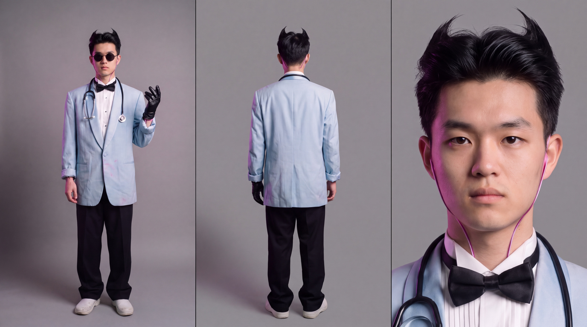

# PROOF — the Wetware character

PROOF is named after the seed thread `w004-proof-of-life`: he is the proof of life. A slight android doctor in a tuxedo built for a man twice his size, working the night feeding round in the Feed Hall.

## The mix

From WET-104 `mix-character-role-models`. Every trait is a nod; PROOF is an original character and resembles no real person or existing design.

| Weight | Role model | What PROOF takes | What he leaves out |
| --- | --- | --- | --- |
| 0.50 | Tetsuwan Atom, *Pluto* variant | A built person who passes as human and is gentle with fragile life; a boyish face; two upswept cowlicks; an android who can cry | The child's body, the boots and shorts, flight, any recognisable design |
| 0.25 | Dr. Strangelove | The black-gloved hand that acts on its own; round dark glasses; stiff formality; the war-room ring light (in the Feed Hall) | The salute, the wheelchair, any likeness |
| 0.25 | Psy, *Gangnam Style* | The powder-blue tuxedo; dark sunglasses; deadpan cool; one crossed-wrist "invisible reins" hop | Any likeness; any choreography beyond that one hop |

The other layers:

- **Wetware** — lab-grown skin, and a magenta fibre-optic seam along each jaw and wrist (from the WET-97 tile of a figure grown from tissue and fibre); the stethoscope; the feeding round.
- **Cantor** — the red suture thread, and the tear.
- **Director** — clothes that do not fit the body, and a face that never plays the joke.

## Locks

These hold in every image and every shot.

- East Asian young-adult android, about 160 cm, slight; a soft boyish face over a defined jaw; warm fair lab-grown skin with real pores.
- Glossy jet-black hair swept up at the crown into two stiff pointed cowlicks.
- A fine translucent seam from behind each ear down the hinge of the jaw to the throat, faint magenta light inside. It is a seam in the skin, never a wire or an earphone cord.
- Round dark wire-frame sunglasses.
- An oversized powder-blue tuxedo jacket worn as a lab coat: black satin peak lapels, rolled cuffs, faint pink stains.
- A white pleated tuxedo shirt, a slightly crooked black satin bow tie, a stethoscope with black tubing.
- Black trousers pooling over white rubber clogs.
- One glossy black leather glove, on the **left** hand. The right hand is always bare.

The glove was written for the right hand, as Strangelove's was, but every image model put it on the left, so the bible follows the images.

## How he was made

| Step | Model | Result |
| --- | --- | --- |
| Sheet from text only | Nano Banana 2, 4K | Rejected: CG-smooth in one take, illustrated in the other. The director never builds a sheet from text alone. |
| Casting photo | Nano Banana Pro, 9:16, 4K ([prompt](prompts/casting-proof.txt)) | Photoreal and the right pose, but a generic face and no cowlicks |
| Casting edit | Nano Banana Pro ([prompt](prompts/casting-proof-edit.txt)) | Locked — [`proof-casting.jpg`](assets/character/proof-casting.jpg) |
| Three-panel sheet from the casting | Nano Banana Pro, 16:9, 4K ([prompt](prompts/character-sheet-proof.txt)) | Locked — [`proof-sheet.jpg`](assets/character/proof-sheet.jpg), passed to Reel 1 as `@Image2` |

The red spool written into his breast pocket did not render on the sheet; in the reels it sits on the Feed Hall table instead.
