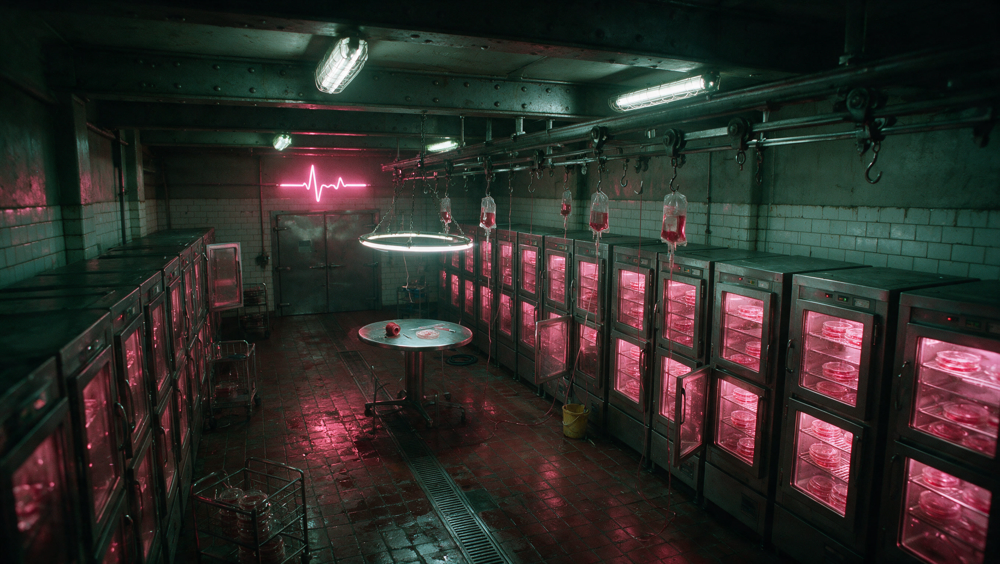

# The Feed Hall — the Wetware environment

A cell-culture feed hall at three in the morning, built into the gutted processing floor of an old abattoir beneath a company tower. The cultures are the mouths to feed.

## Sources

| Source | What it gave the room |
| --- | --- |
| Zeitgeist — *Mouths to Feed*: "a dense urban company tower built atop an immense slaughterfactory… factory farming, faith, and a spiraling famine" | The architecture of a slaughter floor, repurposed: the old meat-line rail and hooks now carry feeding bags of culture medium. Grown, not taken. Slickware Magenta. |
| WET-97 seed — curated [`mj-01`](assets/curated/mj-01-red-aisle.jpg) and [`mj-00`](assets/curated/mj-00-first-spark-neuron.jpg) | Deep black, blood-red and magenta light glowing out of living tissue, and a long converging aisle. Passed to Seedream 5.0 Pro as a palette-only reference. |
| Director — the empty laundromat at night | An empty after-hours room, fluorescent top light plus one saturated neon, lifted blacks, and a plate that "controls materials, atmosphere and light direction only". |
| Strangelove | The round table under a hanging ring of light — the war room. |
| Cantor — *the cure* | A pink neon heartbeat line instead of a sign with words; the spool of red suture thread. |

## Locked landmarks

- Two long banks of stainless incubators glowing magenta through glass doors — the spine of the composition.
- The old meat-line rail overhead, with trolley wheels and stainless hooks holding IV bags of magenta medium, thin feeding lines dropping into the incubators.
- White glazed subway tile to shoulder height, grey-green concrete above.
- A wet oxblood quarry-tile floor with a stainless drain gutter down the centre of the aisle.
- A round stainless table under a hanging fluorescent ring, holding a red suture spool, a glass pipette and a petri dish of pale grown tissue.
- A pink neon heartbeat line above steel swing doors at the far end. No letters anywhere.
- Caged fluorescent tubes, two dimmer and greener at the back; wire carts, a yellow mop bucket, a coiled hose.

There is no blood and no carcass anywhere: the abattoir survives only as architecture, and the bags hold culture medium.

## Plates

| Plate | Model | Status |
| --- | --- | --- |
| [`feed-hall-plate.jpg`](assets/environment/feed-hall-plate.jpg) ([prompt](prompts/location-lock-feed-hall-seeded.txt)) | Seedream 5.0 Pro, 2K, with `mj-01` and `mj-00` as palette references | Locked — `@Image1` in both reels. Deeper magenta tissue-glow; the table props are legible. |
| [`feed-hall-plate-alt.jpg`](assets/environment/feed-hall-plate-alt.jpg) ([prompt](prompts/location-lock-feed-hall.txt)) | Seedream 5.0 Pro, 2K, text only | Alternate — closer to the director's lifted-grey grade. |
